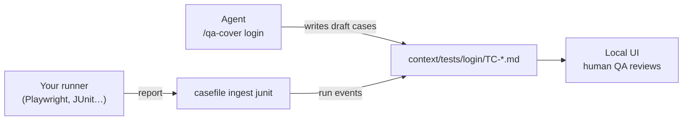

# casefile

**Your test cases live in your repo, next to the code they verify. Your AI agent writes and maintains them; you review.**

> **Preview.** casefile is under active development and not yet published to npm.
> Everything below marked *Today* works from source; *Next* is planned, not built.

## What it does

Most teams keep test cases in a test-management tool (Zephyr, Xray, TestRail),
far from the code. They go stale, nobody knows which ones are automated, and an
AI agent can't read or update them.

casefile moves them into the repository as plain files:

- **One case = one Markdown file** under `context/tests/<feature>/TC-NNNN.md`,
  versioned with Git and reviewed in pull requests like any other change.
- **Your AI agent does the writing.** Through skills (Claude Code, Codex, …) it
  proposes cases for a feature, links them to the tests that automate them, and
  records the results of your test runs.
- **A human QA stays in charge.** Every case the agent proposes starts as a
  `draft`, and a local UI shows the whole picture without touching a file.
- **Your test runner stays yours.** Playwright, JUnit, Surefire… casefile does
  not run tests; it reads their reports and matches each result to its case.
- **Test-management tools become mirrors**, never the source of truth.



casefile has no LLM inside: you bring your own agent. The framework gives it
the rules (SPECs it reads with `casefile spec <name>`), a CLI that validates
every file, and an exact error list to fix until the workspace is clean.

## See it on a real example

[`examples/npm-login`](examples/npm-login/) is a small product repository whose
sign-in page (the public <https://www.npmjs.com/login>) is covered through the
real flow, not by hand:

1. The human ran `casefile init`; the agent ran `/casefile-setup` and registered
   the project.
2. The agent ran `/qa-cover login` and wrote **9 draft cases**: 6 front-end
   checks linked to Playwright tests, 3 that need a real account, kept manual.
3. The product's own `npx playwright test` produced a JUnit report.
4. `casefile ingest junit` matched all 6 results to their cases.

A case the agent wrote ([`TC-0004.md`](examples/npm-login/context/tests/login/TC-0004.md)):

```markdown
---
id: TC-0004
feature: login
title: Move through the form with the keyboard
state: draft
origin: agent
automation:
  ref: login.spec.ts::moves through the form with the keyboard
steps:
  - do: Focus Username and press Tab twice
    expect: Focus goes to the Forgot password? link, then to Password
history:
  - at: "2026-10-17T19:22:51Z"
    by: amarturelo@gmail.com
    via: cli:cover
    change: 1aaddeb0-ca7c-4dca-8690-a5c779d7c240
    event: created
---
```

`automation.ref` is the Playwright test (`<file>::<title>`) that automates it.
Priority, layer and surface aren't repeated in each case: they're inherited from
[`_common.yaml`](examples/npm-login/context/tests/_common.yaml). Run results are
appended, never rewritten, to
[`.runs/local-2026-10-17-1.jsonl`](examples/npm-login/context/tests/.runs/local-2026-10-17-1.jsonl).

Try it from a clone of this repository:

```bash
pnpm install && pnpm build
node scripts/link-toolchain.mjs examples/npm-login
pnpm casefile overview --cwd examples/npm-login
pnpm ui --cwd examples/npm-login
```

Then open <http://127.0.0.1:4321>. The [example's README](examples/npm-login/README.md)
explains every step, what each case shows and the gaps it found.

## Add casefile to your repository

casefile needs Node 22+ and Git. Your product's `package.json` is never
touched: casefile pins itself in its own `.casefile/` directory.

### Once it's published (Next)

```bash
npx @casefile/cli init --skills-into .claude/skills
```

Use `.agents/skills` instead for Codex. Never `npx casefile`: that npm name is
an unrelated package.

### Today, from source

Until the first npm release, build casefile once and link it into your repo:

```bash
git clone https://github.com/albertomarturelo/testbed.git casefile
cd casefile && pnpm install && pnpm build
```

Then, from your repository's root (replace `../casefile` with where you cloned it):

```bash
node ../casefile/apps/cli/dist/bin.js init --skills-into .claude/skills
node ../casefile/scripts/link-toolchain.mjs .
```

`link-toolchain` stands in for the `npm install --prefix .casefile` step of the
setup until `@casefile/cli` is on npm; tell your agent the toolchain is already
linked, and it runs as `.casefile/node_modules/.bin/casefile`.

### Then, in your agent

Below, `casefile` means `.casefile/node_modules/.bin/casefile` in your
repository (the toolchain `init` pinned); the skills already call it that way.

1. **`/casefile-setup`**: the agent explores the repo (a single project or a
   monorepo), asks you **once** to confirm a plan (projects, default priority,
   layer, surfaces, review mode), registers the projects and loops on
   `casefile validate` until it exits 0. It commits the setup as
   `casefile-agent`.
2. **`/qa-cover <feature>`**: say what to cover in your own words ("the sign-in
   page: validation, keyboard, accessibility; whatever needs an account as
   manual"). The agent writes the cases as `draft`, linking each automatable one
   to its test, and commits them.
3. **Ingest your test results** from a JUnit XML report (Playwright, Surefire, …):

   ```bash
   CASEFILE_ACTOR=agent casefile ingest junit results/junit.xml \
     --run local-1 --executor agent:claude-code
   ```

4. **Look at it**: `pnpm ui --cwd /absolute/path/to/your-repo` from the
   casefile clone, then open <http://127.0.0.1:4321>; or `casefile overview` in
   the terminal.

Every command has `--help`, `--json` for scripts and agents, and a SPEC:

| Command | What it does |
|---|---|
| `casefile init` | Creates `casefile.yaml` and `.casefile/`, offers the skills |
| `casefile project add` | Registers a project and scaffolds its `context/tests/` |
| `casefile validate` | Checks the whole workspace; lists every problem with how to fix it |
| `casefile cover` | Writes the cases the agent proposes for a feature, as drafts |
| `casefile ingest junit` | Turns a JUnit report into run events matched by `automation.ref` |
| `casefile overview` | Every project with its cases, automation status and last run |
| `casefile query` | Lists the cases a query selects (`priority = P1 and state = draft`) |
| `casefile resolve` | Shows a case after inheritance, with where each value came from |
| `casefile id next` | The next free case id of a project |
| `casefile spec <name>` | Prints the SPEC of an operation or topic |

## Principles

- **Files are the source of truth.** No database, no hidden state: everything is
  recomputable from the repo.
- **Git is identity.** Who changed a case and why comes from commits and
  their trailers, not from accounts.
- **The agent is the only writer of cases**, through operations with a limited
  scope; humans express intent and review.
- **Bring your own agent.** casefile never calls an LLM.
- **A feature tree, not a calendar.** Cases are organised by what they verify,
  not by sprint or test cycle.
- **One query language** for the CLI, the UI and release gates.
- **Extensible by operations.** Ingesters, bridges and validators plug into the
  same registry the built-ins use.
- **Mirrors, not masters.** Zephyr, Xray and TestRail receive copies; they are
  never where a case is born.

The reasons behind each one are in [docs/decisions](docs/decisions/_index.md).

## Today / Next

| Today (from source) | Next |
|---|---|
| `init`, `project add`, `validate`, `cover`, `overview`, `query`, `resolve`, `id next`, `spec` | Publish `@casefile/cli` to npm |
| Skills `casefile-setup` and `qa-cover` | Skills `qa-bootstrap`, `qa-run`, `qa-release`, `qa-inbox`, `qa-review` |
| `ingest junit` (Playwright, Surefire) | CTRF and Allure ingesters; marking environment-blocked results as `blocked` |
| Read-only local UI (`pnpm ui`) | Run history and failure reasons in the UI; live reload; Inbox and Release screens |
| Release gate evaluation in core | `casefile gates` on the CLI and in the UI |
| | MCP server; Zephyr and Xray bridges; a documented way for CI to commit its run files |

Planned work is tracked in [issues](https://github.com/albertomarturelo/testbed/issues).

## Develop casefile

A pnpm + Turborepo monorepo in strict TypeScript: `packages/core` holds the
logic, `apps/cli` and `apps/web` are thin hosts over it, `skills/` holds the
agent skills. Start with [ARCHITECTURE](docs/ARCHITECTURE.md) and
[CONVENTIONS](docs/CONVENTIONS.md).

```bash
pnpm install
pnpm build
pnpm test
pnpm lint
```

## License

[MIT](LICENSE)
