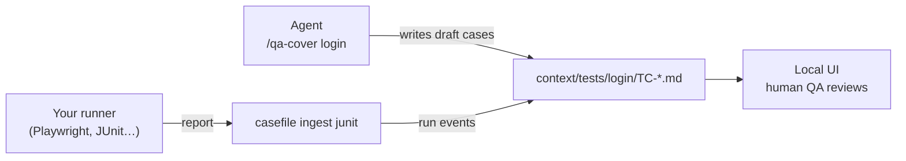

# casefile

**Your test cases live in your repo, next to the code they verify. Your AI agent writes and maintains them; you review.**

> **Preview (`0.x`).** casefile is under active development: a breaking change
> bumps the minor version. The CLI is on npm as `@casefile/cli` and
> opens the viewer with `casefile ui`. *Today* works; *Next* is planned, not
> built.

## What it does

Most teams keep test cases in a test-management tool (Zephyr, Xray, TestRail),
far from the code. They go stale, nobody knows which ones are automated, and an
AI agent can't read or update them.

casefile moves them into the repository as plain files:

- **One case = one Markdown file** under `context/tests/<feature>/TC-NNNN.md`,
  versioned with Git and reviewed in pull requests like any other change.
- **Your AI agent does the writing.** Through skills (Claude Code, Codex, …) it
  proposes cases for a feature, links them to the tests that automate them, and
  records the results of your test runs.
- **A human QA stays in charge.** Every case the agent proposes starts as a
  `draft`, and a local UI shows the whole picture without touching a file.
- **Your test runner stays yours.** Playwright, JUnit, Surefire… casefile does
  not run tests; it reads their reports and matches each result to its case.
- **Test-management tools become mirrors**, never the source of truth.



casefile has no LLM inside: you bring your own agent. The framework gives it
the rules (SPECs it reads with `casefile spec <name>`), a CLI that validates
every file, and an exact error list to fix until the workspace is clean.

## See it on a real example

[`examples/npm-login`](examples/npm-login/) is a small product repository whose
sign-in page (the public <https://www.npmjs.com/login>) is covered through the
real flow, not by hand:

1. The human ran `casefile init`; the agent ran `/casefile-setup` and registered
   the project.
2. The agent ran `/qa-cover login` and wrote **9 draft cases**: 6 front-end
   checks linked to Playwright tests, 3 that need a real account, kept manual.
3. The product's own `npx playwright test` produced a JUnit report.
4. `casefile ingest junit` matched all 6 results to their cases.

A case the agent wrote ([`TC-0004.md`](examples/npm-login/context/tests/login/TC-0004.md)):

```markdown
---
id: TC-0004
feature: login
title: Move through the form with the keyboard
state: draft
origin: agent
automation:
  ref: login.spec.ts::moves through the form with the keyboard
steps:
  - do: Focus Username and press Tab twice
    expect: Focus goes to the Forgot password? link, then to Password
history:
  - at: "2026-10-17T19:22:51Z"
    by: amarturelo@gmail.com
    via: cli:cover
    change: 1aaddeb0-ca7c-4dca-8690-a5c779d7c240
    event: created
---
```

`automation.ref` is the Playwright test (`<file>::<title>`) that automates it.
Priority, layer and surface aren't repeated in each case: they're inherited from
[`_common.yaml`](examples/npm-login/context/tests/_common.yaml). Run results are
appended, never rewritten, to
[`.runs/local-2026-10-17-1.jsonl`](examples/npm-login/context/tests/.runs/local-2026-10-17-1.jsonl).

Try it from a clone of this repository:

```bash
pnpm install && pnpm build
node scripts/link-toolchain.mjs examples/npm-login
pnpm casefile overview --cwd examples/npm-login
pnpm casefile runs TC-0003 --cwd examples/npm-login
pnpm ui --cwd examples/npm-login
```

Then open <http://127.0.0.1:4321>. The [example's README](examples/npm-login/README.md)
explains every step, what each case shows and the gaps it found.

## Add casefile to your repository

casefile needs Node 22+ and Git. Your product's `package.json` is never
touched: casefile pins itself in its own `.casefile/` directory.

### Install

From your repository's root:

```bash
npx @casefile/cli init --skills-into .claude/skills
```

Use `.agents/skills` instead for Codex. Never `npx casefile`: that npm name is
an unrelated package. `init` pins `@casefile/cli` and the viewer
`@casefile/web` in `.casefile/package.json`;
the setup skill installs them there (`npm install --prefix .casefile
--ignore-scripts`), so every clone of your repository runs the same version.

### Let your agent install it

Or tell your agent, in your repository:

> Install casefile following
> https://github.com/albertomarturelo/testbed/blob/main/QUICKSTART.md

[QUICKSTART.md](QUICKSTART.md) is written for the agent: it picks the release,
uses npm or the tarball below, asks you once, runs `init` for you and
continues with the setup.

### Without the npm registry

If your network blocks `registry.npmjs.org` but reaches GitHub, use the
toolchain tarball attached to each
[release](https://github.com/albertomarturelo/testbed/releases) from `v0.1.1`.
It is the `node_modules/` npm would install (casefile, its viewer from
`v0.1.2`, `yaml`, `zod`), built
from the same packages
([why](docs/decisions/2026-11-09-release-toolchain-tarball.md)). From your
repository's root, with `v` set to the release you want:

```bash
v=<x.y.z>
base=https://github.com/albertomarturelo/testbed/releases/download/v$v
curl -fsSLO "$base/casefile-toolchain-$v.tgz"
curl -fsSLO "$base/casefile-toolchain-$v.tgz.sha256"
shasum -a 256 -c "casefile-toolchain-$v.tgz.sha256"
mkdir -p .casefile && tar -xzf "casefile-toolchain-$v.tgz" -C .casefile
rm "casefile-toolchain-$v.tgz" "casefile-toolchain-$v.tgz.sha256"
.casefile/node_modules/.bin/casefile init --skills-into .claude/skills
```

Only unpack it if the checksum says `OK`. `.casefile/node_modules/` is
ignored by Git, so each clone repeats the download; to upgrade, change the pin
in `.casefile/package.json`, delete `.casefile/node_modules` and unpack the
new version, then run `init --skills-into` again for the skills the new version
adds (it never overwrites the ones you have). Tell your agent the toolchain is
already installed. Extensions are not in the tarball and still need npm.

### Upgrading from `0.1.x` to `0.2.x`

`0.2.0` changed what casefile commits and how executions are grouped:

1. **Pins.** Set `@casefile/cli` and `@casefile/web` to the new version
   (`0.2.1`) in `.casefile/package.json`, delete `.casefile/node_modules` and
   install again (`npm install --prefix .casefile --ignore-scripts`, or unpack
   that version's tarball).
2. **Commit subjects.** casefile's commits now read like the rest of the
   history, `test(web): propose 2 cases` by default. If the repository has its
   own rules (a ticket key first, no AI tool named), describe them in a
   `commit:` section of `casefile.yaml` (`casefile spec cover`, *Commit
   subject*); `casefile validate` checks it.
3. **Milestones.** `--release` is now `--milestone`, and it must name a
   milestone opened first:
   `casefile milestone open web-2.1.0 --title "Web 2.1.0"`. `--release` keeps
   working as its old name until `1.0`, run files are never rewritten, and
   gate scopes still read `release.*`. `casefile validate` warns about old
   releases no milestone declares (`run.undeclared_milestone`): open one with
   the same slug to group them.
4. **Skills.** Their text changed (they read the `commit` section), and
   `init` never overwrites a skill you have. Run
   `.casefile/node_modules/.bin/casefile init`: it lists the skills whose text
   differs from the new version's as `stale` and prints the command that
   replaces them. Run it only for skills you have not edited.

From `0.2.0` to `0.2.1` only step 1 applies; case bodies then render as
Markdown in the viewer, and `casefile init` says whether any skill is stale.

### From source

To try what is on `main` before it is released, build casefile once and link
it into your repo:

```bash
git clone https://github.com/albertomarturelo/testbed.git casefile
cd casefile && pnpm install && pnpm build
```

Then, from your repository's root (replace `../casefile` with where you cloned it):

```bash
node ../casefile/apps/cli/dist/bin.js init --skills-into .claude/skills
node ../casefile/scripts/link-toolchain.mjs .
```

`link-toolchain` stands in for the `npm install --prefix .casefile` step of the
setup; tell your agent the toolchain is already linked, and it runs as
`.casefile/node_modules/.bin/casefile`.

### Then, in your agent

Below, `casefile` means `.casefile/node_modules/.bin/casefile` in your
repository (the toolchain `init` pinned); the skills already call it that way.

1. **`/casefile-setup`**: the agent explores the repo (a single project or a
   monorepo), asks you **once** to confirm a plan (projects, default priority,
   layer, surfaces, review mode), registers the projects and loops on
   `casefile validate` until it exits 0. It commits the setup as
   `casefile-agent`.
2. **`/qa-bootstrap <project>`**: the agent reads the project (README, screens,
   its automated tests), shows you **one** plan (a feature tree and the first
   case titles per feature, which ones link to a test, which ones stay manual),
   and after your answer writes them as `draft`, one commit per feature. Later,
   **`/qa-cover <feature>`** adds cases to one feature: say what to cover in your
   own words ("the sign-in page: validation, keyboard, accessibility; whatever
   needs an account as manual").
3. **Read the drafts and ask in the chat**: open the viewer (step 5) and tell the
   agent what to change: **`/qa-review`** ("TC-0003 must keep the email filled
   in; approve TC-0002 and TC-0004"). It applies each change through `casefile
   review`, one commit per case, and approves only what you asked. You can also
   edit and approve from the case page yourself.
4. **Ingest your test results** from a JUnit XML report (Playwright, Surefire, …):

   ```bash
   CASEFILE_ACTOR=agent casefile ingest junit results/junit.xml \
     --run local-1 --executor agent:claude-code
   ```

5. **Look at it**: `casefile overview` in the terminal, and the viewer with
   `casefile ui`, then open <http://127.0.0.1:4321> (`--port <n>` for another
   port). A repository set up before `0.1.2` pins only the CLI: `casefile ui`
   answers `ui.not_installed` and its hint says how to add the viewer.

Every command has `--help`, `--json` for scripts and agents, and a SPEC:

| Command | What it does |
|---|---|
| `casefile init` | Creates `casefile.yaml` and `.casefile/`, offers the skills |
| `casefile project add` | Registers a project and scaffolds its `context/tests/` |
| `casefile validate` | Checks the whole workspace; lists every problem with how to fix it |
| `casefile cover` | Writes the cases the agent proposes for a feature, as drafts |
| `casefile review` | Edits, approves or retires one case, for the agent or the QA |
| `casefile run` | Records the result of a case someone executed by hand; casefile runs nothing |
| `casefile milestone open` | Declares a milestone (a release to certify, a sprint regression, a UAT round) that executions name with `--milestone` |
| `casefile milestone list` | Every milestone with its progress (executed, passed) and red gates; `--open` for the ones an execution can name |
| `casefile milestone report` | The evidence of a milestone: totals, gate verdicts, the latest result of each case and the cases not executed |
| `casefile milestone close` | Freezes that evidence in `context/milestones/<slug>/evidence.md` and closes the milestone, in one commit |
| `casefile gates` | Each release gate of the project, green or red with its reasons, for the executions in one milestone (`--date` for triages, `--build`) |
| `casefile ingest junit` | Turns a JUnit report into run events matched by `automation.ref` |
| `casefile overview` | Every project with its cases, automation status and last run |
| `casefile runs` | One case's run events, newest first, with why each one failed |
| `casefile query` | Lists the cases a query selects (`priority = P1 and state = draft`) |
| `casefile resolve` | Shows a case after inheritance, with where each value came from, and its Markdown body |
| `casefile id next` | The next free case id of a project |
| `casefile spec <name>` | Prints the SPEC of an operation or topic |
| `casefile ui` | Opens the viewer for this workspace on `127.0.0.1`; it runs the `@casefile/web` that `init` pins next to the CLI |
| `casefile whoami` | Who writes are made as: `CASEFILE_USER_EMAIL` when set, else `git config user.email` |

## Principles

- **Authoring first.** The product is a QA and an agent writing, maintaining and
  reading cases from the code; a case is complete without a run. Results and
  CI are a complement.
- **Files are the source of truth.** No database, no hidden state: everything is
  recomputable from the repo.
- **Git is identity.** Who changed a case and why comes from commits and
  their trailers, not from accounts. On a shared machine, `CASEFILE_USER_EMAIL`
  names the QA without touching git config.
- **Cases are written only through core operations**, by the agent or the QA
  from the viewer; Git says who. Nobody hand-edits YAML.
- **Bring your own agent.** casefile never calls an LLM.
- **A feature tree, not a calendar.** Cases are organised by what they verify,
  not by sprint or test cycle.
- **One query language** for the CLI, the UI and release gates.
- **Extensible by operations.** Ingesters, bridges and validators plug into the
  same registry the built-ins use.
- **Mirrors, not masters.** Zephyr, Xray and TestRail receive copies; they are
  never where a case is born.

The reasons behind each one are in [docs/decisions](docs/decisions/_index.md).

## Today / Next

| Today (`0.2.1`) | Next (ranked by the [authoring loop](docs/decisions/2026-10-19-authoring-loop-first.md)) |
|---|---|
| `init`, `project add`, `validate`, `cover`, `review` (edit, approve, retire a case), `run` (record a result by hand), `milestone open`, `list`, `report` and `close`, `gates`, `overview`, `runs`, `query`, `resolve`, `id next`, `whoami`, `spec` | |
| Milestones group the executions of a release, a sprint regression or a UAT round; closing one freezes its evidence in `evidence.md`, in a commit that the repository signs when it signs commits ([decided](docs/decisions/2026-11-12-milestones-group-executions.md)) | Fail a CI step on red gates (#171), a Markdown summary for workflows and PRs (#115) |
| casefile's commits follow the repository's conventions: a subject template in `casefile.yaml`, Conventional by default, with a ticket key when the repository asks, and the `Agent:` trailer optional ([decided](docs/decisions/2026-11-12-commit-shape-follows-host-repo.md)) | |
| Skills `casefile-setup`, `qa-bootstrap` (a project's feature tree and first drafts from its code), `qa-cover` and `qa-review` (change, approve or retire cases from the chat); `init` says which skills an upgraded repository has stale, how to replace them, and which skill to run next | |
| Local UI (`casefile ui`, installed with the CLI): projects, feature tree with coverage, cases that read as documents, each case's runs and why they failed; the QA creates a case, edits, approves and retires it, and records a manual result into a milestone, with the case open in a sheet over the list; a Milestones view with progress, open and close, and evidence to print or save as PDF; case bodies rendered as Markdown ([decided](docs/decisions/2026-10-19-human-writes-through-operations.md), [Markdown](docs/decisions/2026-11-13-case-body-markdown.md)) | Live reload (#26) |
| `@casefile/cli`, `@casefile/web` (the viewer, [decided](docs/decisions/2026-11-09-casefile-ui-command.md)) and `@casefile/core` on npm, published by CI with provenance ([release process](docs/decisions/2026-10-20-release-process.md)); a toolchain tarball on each GitHub release for networks without the npm registry ([decided](docs/decisions/2026-11-09-release-toolchain-tarball.md)) | |
| `ingest junit` (Playwright, Surefire), keeping failure messages and attachments; `ingest` returns the commit, and `casefile spec ci` has a GitHub Actions template that records shared-branch runs as `casefile-ci` ([decided](docs/decisions/2026-10-17-ci-commits-run-files.md)) | |
| Release gates per milestone: `casefile gates`, and their verdicts in the evidence | Complements, when the real case needs them: CTRF and Allure, environment-blocked results, MCP, Zephyr and Xray bridges |

Planned work is tracked in [issues](https://github.com/albertomarturelo/testbed/issues).

## Develop casefile

A pnpm + Turborepo monorepo in strict TypeScript: `packages/core` holds the
logic, `apps/cli` and `apps/web` are thin hosts over it, `skills/` holds the
agent skills. Start with [ARCHITECTURE](docs/ARCHITECTURE.md) and
[CONVENTIONS](docs/CONVENTIONS.md).

```bash
pnpm install
pnpm build
pnpm test
pnpm lint
```

**Releasing** ([ADR release-process](docs/decisions/2026-10-20-release-process.md)):
`@casefile/core`, `@casefile/cli` and `@casefile/web` share one version. Open a PR with
`node scripts/release.mjs set <x.y.z>` (it also updates the examples' pins),
titled `chore(release): v<x.y.z>`. This README is the npm page of
`@casefile/cli` and npm keeps it per version, so the same PR updates the
install section and the Today / Next table when the release changes them. After it merges, the maintainer tags that
commit `v<x.y.z>` on `main` and pushes the tag; the Release workflow checks,
packs, smoke-tests and publishes them with provenance, and attaches the
toolchain tarball and its checksum to the GitHub release. Running the workflow
by hand is a dry run.

## License

[MIT](LICENSE)
